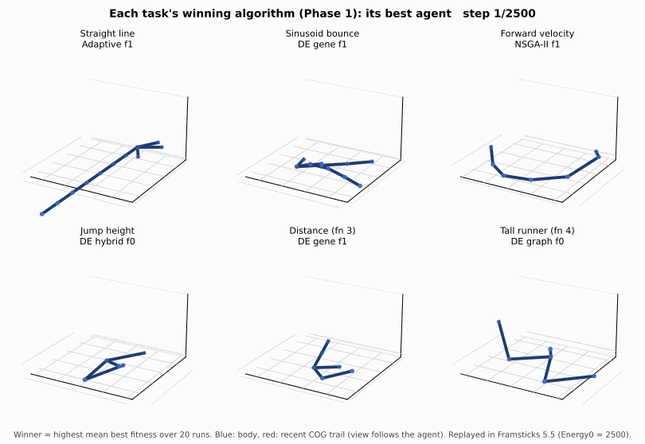
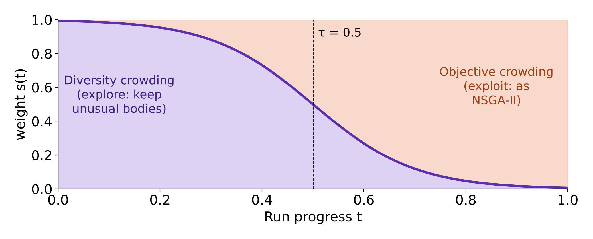
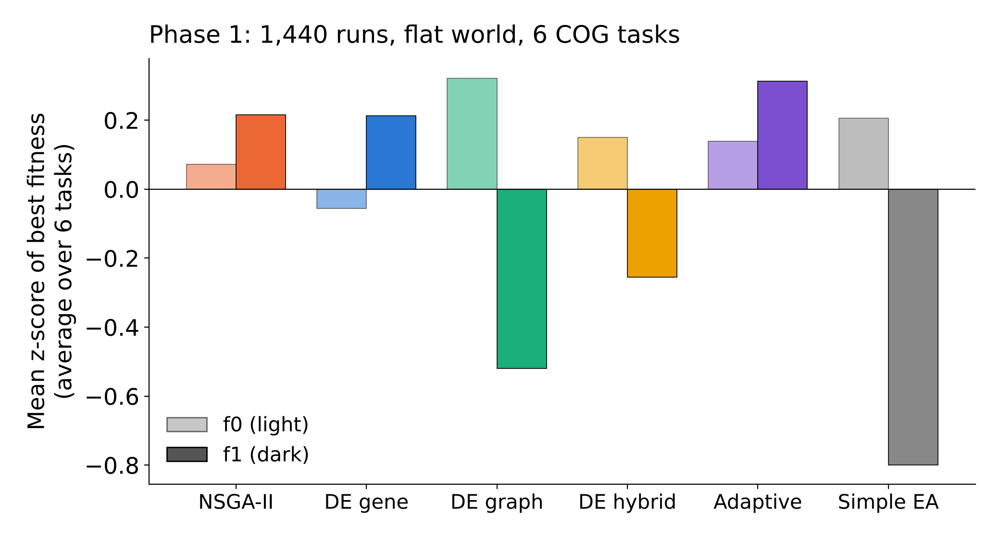
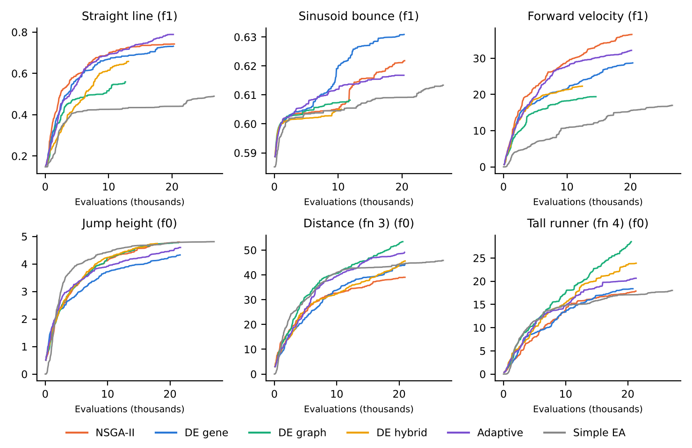
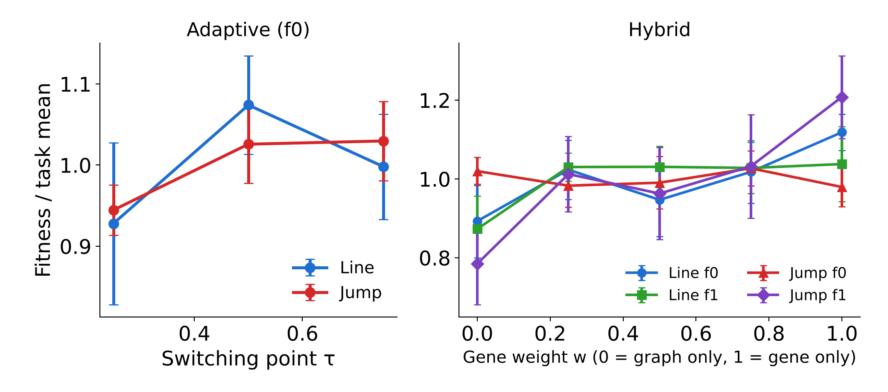
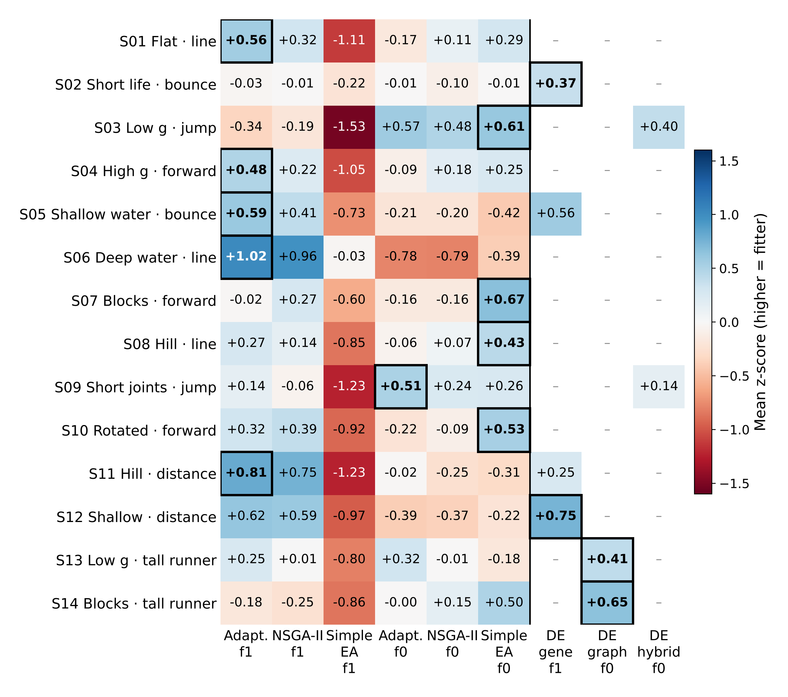
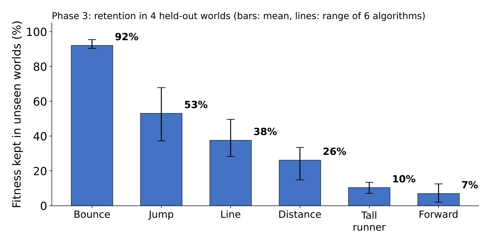

# Diversity-Enhanced Evolutionary Optimisation of 3D Agents in Framsticks

**COS700 Honours Research Project · Department of Computer Science · University of Pretoria · 2026**

Salmaan Patel · Vanessa Rampedi · Ntsako Sithole
Supervisors: Prof. N. Pillay and Dr. T. Nyathi

*For each of the six tasks, the best run of the task's winning algorithm (highest mean best
fitness over 20 runs in Phase 1), replayed in Framsticks. Blue: the body (sticks joined at
parts); red: the recent path of its centre of gravity.*

## Links

| | |
|---|---|
| Main code repository | [KENJI-MASAMUNE/Optimizing-3D-Agents---GECCO-Competition](https://github.com/KENJI-MASAMUNE/Optimizing-3D-Agents---GECCO-Competition) (private until the report has been marked; ask a team member for access) |
| Poster (Poster Day, 29 October 2026) | [poster/COS700_Poster.pdf](poster/COS700_Poster.pdf) |
| Research report | [report/COS700_Research_Report.pdf](report/COS700_Research_Report.pdf) |
| Best evolved creatures | [Phase 1](genotypes/best_phase1.gen) and [Phase 3](genotypes/best_phase3.gen) genotypes (open in Framsticks, see below) |

## In one minute

**Problem.** We evolve virtual creatures in the [Framsticks](https://www.framsticks.com)
simulator whose centre of gravity (COG) must move in a required way: follow a straight line,
bounce, move forward, jump, travel far, or run tall. Body and brain evolve together, the
search space is rugged, and evolutionary algorithms tend to get stuck early on one body plan.

**Idea.** DE-NSGA-II (Komosinski & Mensfelt, GECCO 2025) keeps the population diverse by
replacing NSGA-II's crowding distance with how *different* each creature is from the others,
either in its genes or in its body. We tested it on tasks and worlds modelled on the
[GECCO Automated Design Competition](https://www.framsticks.com/gecco-competition). The
competition's real settings are hidden, so we rebuilt 14 competition-style settings from the
parameters the organisers say can change (gravity, water, terrain, lifespan, body limits,
rotation). We also added a new variant, **Adaptive DE-NSGA-II**, which favours diversity early in the run and fitness late.

**What we compared.** Five algorithms on one shared engine (NSGA-II; DE-NSGA-II with gene,
graph or hybrid crowding; Adaptive DE-NSGA-II) and the competition organisers' **Simple EA**,
each with the f0 and f1 genetic encodings: 3,780 runs on the CHPC Lengau cluster.

## Main findings

1. **Diversity is not the same as fitness.** Fixed DE-NSGA-II kept the best solutions more
   diverse, but it was never significantly fitter than plain NSGA-II.
2. **Adaptive DE-NSGA-II was the most consistent algorithm.** Exploring early and exploiting
   late removed the fitness cost of diversity: it was significantly better than gene-based
   DE-NSGA-II across tasks (p = 0.034) and the best general algorithm with f1 in our
   reconstructed competition-style worlds, but its lead over NSGA-II was not significant.
3. **The encoding mattered more than the crowding rule.** f1 suited the movement tasks, f0
   suited jumping, and structural (graph) crowding was too slow for f1 bodies.
4. **The Simple EA is a strong baseline.** It was beaten on f1 in 13 of 14 settings, but never
   significantly beaten on f0.
5. **Generalisation is the open problem.** The best agents kept only 32–40% of their fitness in
   worlds they had not seen during evolution.

## Results

### Phase 1: controlled comparison (1,440 runs, 6 tasks)

| Task | Best algorithm (mean) |
|---|---|
| Straight line | Adaptive DE-NSGA-II, f1 |
| Sinusoid bounce | DE-NSGA-II gene, f1 |
| Forward velocity | NSGA-II, f1 |
| Jump height | DE-NSGA-II hybrid, f0 |
| Distance (organisers' function 3) | DE-NSGA-II gene, f1 |
| Tall runner (organisers' function 4) | DE-NSGA-II graph, f0 |

### Phase 2: sensitivity (500 runs)

No setting had a significant effect (all p ≥ 0.145). Switching to fitness early (τ = 0.25) and
graph-only hybrid crowding (w = 0) were the weakest choices.

### Phase 3: 14 reconstructed competition-style worlds and 4 held-out worlds (1,840 runs)

## Watch the creatures yourself

1. Download Framsticks from <https://www.framsticks.com> (version 5.5 was used).
2. Download [genotypes/best_phase1.gen](genotypes/best_phase1.gen) (72 creatures, flat
   reference world) or [genotypes/best_phase3.gen](genotypes/best_phase3.gen) (92 creatures
   from the 14 reconstructed competition-style worlds).
3. In Framsticks: **File → Open…** and choose the file. Phase 1 names follow
   *task, encoding, algorithm, fitness, run*, e.g. `jump f0 hybrid 5.573 r4`; Phase 3 names
   start with the setting, e.g. `S07 vel f0 adaptive 19.172 r8`.
4. Select a genotype, add it to the world and start the simulation to watch it move.

Each file holds the best run of every task × encoding × algorithm combination (and, for
Phase 3, every setting). Our experiments used a lifespan of Energy0 = 2500; Framsticks' default
world gives creatures a longer life, so they may keep moving for longer than in our runs. A
Phase 3 creature behaves as it did during evolution only in its own world (gravity, water,
terrain): [genotypes/README.md](genotypes/README.md) lists the settings to use.

## Acknowledgements

We thank our supervisors Prof. N. Pillay and Dr. T. Nyathi, and the Centre for High Performance
Computing (CHPC), South Africa, for compute time on the Lengau cluster. Framsticks is developed
by M. Komosinski, S. Ulatowski and contributors.

## References

1. M. Komosinski and A. Mensfelt, "Enhancing quality-diversity optimization through
   domain-specific dissimilarity as crowding distance," GECCO 2025, pp. 898–906.
   doi:10.1145/3712256.3726459
2. Automated Design Competition at GECCO 2024–2026, <https://www.framsticks.com/gecco-competition>
3. K. Deb, A. Pratap, S. Agarwal and T. Meyarivan, "A fast and elitist multiobjective genetic
   algorithm: NSGA-II," IEEE Transactions on Evolutionary Computation, 6(2), 2002.
